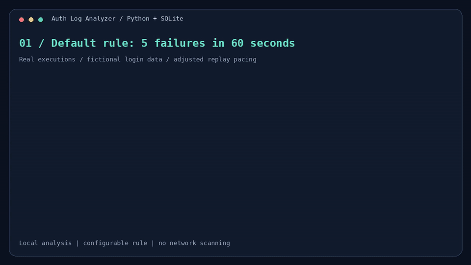

# 🔐 Auth Log Analyzer

A Python and SQLite tool that analyzes login logs and flags repeated authentication failures by IP address. This is a defensive cybersecurity study project, developed with AI assistance to explore programming, databases, and log analysis. It runs locally in the terminal and uses fictional sample data.

## 📦 Technologies

- `Python 3.12+`
- `SQLite` — storing events, alerts, and analysis settings
- `argparse` — command-line options
- `csv`, `json`, `datetime`, and `ipaddress` — reading, validating, and exporting data
- `collections.deque` — maintaining the detection window
- `unittest` — automated tests
- `Git` and `GitHub` — version control and documentation

The analyzer uses only the Python standard library. No external packages are required to run it.

## 🦄 Features

Here's what you can do with Auth Log Analyzer:

- **Analyze Login Records:** Load a normalized CSV file containing login timestamps, IP addresses, usernames, and outcomes.
- **Detect Repeated Failures:** Flag IPs with at least five failed logins within 60 seconds using the default rule.
- **Customize the Rule:** Change the failure threshold and time window to compare different detection scenarios.
- **Validate the Input:** Check IPv4/IPv6 addresses, timezone-aware timestamps, usernames, and login outcomes. Invalid rows are recorded with an explanation.
- **Export the Results:** Read a Markdown summary, inspect the JSON report, or query the SQLite database.
- **Keep Previous Analyses:** Save each run in a new directory so existing reports are preserved.
- **Experiment with Sample Data:** Run a fictional dataset and explore how changing the rule changes the results.

An alert identifies a pattern to investigate; it does not confirm an attack.

### 🎯 Keyboard Shortcuts

The project is a command-line tool. These are **standard Linux/Bash terminal shortcuts**, rather than shortcuts implemented by the application:

| Shortcut | Action |
| --- | --- |
| `Enter` | Execute a command |
| `↑` / `↓` | Browse command history |
| `Tab` | Complete commands or file paths when supported by the shell |
| `Ctrl + C` | Interrupt the running command |
| `Ctrl + L` | Clear the terminal display |

Use `python3 logwatch.py --help` to see the application's command-line options.

## 👩‍🍳 The Process

The project started with a small question: how can repeated login failures be identified in a set of authentication records? A fictional CSV dataset made it possible to reproduce both concentrated failures and ordinary activity.

The first step was input validation. Each row is checked before analysis, and timestamps are converted to UTC. Invalid rows are kept separate so they do not silently affect the detection results.

Next came the detection logic. Failed logins are grouped by IP and sorted by time. A rolling window keeps track of failures inside the configured interval. Each IP that reaches the threshold receives one alert describing its largest failure window.

The results are then saved in SQLite and exported as Markdown and JSON reports. The code separates reading, detection, reporting, and storage into functions in `logwatch.py`.

Finally, automated tests were added for boundary conditions, invalid inputs, and complete output generation. The demonstration below was generated from real command executions. I am studying this implementation and using the [Portuguese guide](docs/GUIA_PT_BR.md) to work through it and make my own changes.

## 📚 What I'm Learning

### 🐍 Working with Python

- Reading structured files and validating their contents.
- Separating responsibilities into functions and small data classes.
- Using command-line arguments to make a tool configurable.

### ⏱️ Detection Logic

- Comparing timestamps and understanding an inclusive time window.
- Using a `deque` to maintain a rolling window of events.
- Distinguishing an alert from a confirmed security incident.

### 🗃️ Databases and Reports

- Organizing events and alerts in SQLite tables.
- Using parameterized SQL queries to keep input values separate from SQL instructions.
- Exporting the same analysis in human-readable and machine-readable formats.

### 🧪 Testing and Documentation

- Checking thresholds, time boundaries, and malformed input.
- Comparing results after changing one parameter.
- Documenting commands and expected outputs so another person can reproduce them.

Running the sample with different settings already showed me why the time interval matters: six failures in 60 seconds flags no IPs in the sample, while three failures in 300 seconds flags two. The remaining topics are part of my ongoing study.

## 💭 How Can It Be Improved?

- Add a parser for a real authentication log format, such as SSH logs.
- Add account-based detection alongside IP-based detection.
- Compare possible false positives across more realistic fictional scenarios.
- Introduce optional duplicate handling using a documented event identifier.
- Process large files incrementally instead of loading every event into memory.
- Run the tests automatically through GitHub Actions.

Currently, the tool analyzes a file offline. Shared IPs can cause false positives, distributed attempts may fall below the per-IP threshold, and successful logins do not reset the failure count.

## 🚦 Running the Project

You need **Python 3.12 or newer**.

**1. Clone the repository and enter its directory:**

```bash
git clone https://github.com/Cat027/auth-log-analyzer.git
cd auth-log-analyzer
```

**2. Run the sample analysis:**

```bash
python3 logwatch.py data/sample_logins.csv --output reports/demo
```

Expected output:

```text
Valid events: 12 | Rejected rows: 0
Flagged IPs: 1
  203.0.113.10: 5 failures in the peak window
Reports saved to: reports/demo
```

**3. Open `reports/demo/report.md` to read the result.** The same directory contains `report.json` and `analysis.db`. You can also view the committed [sample report](docs/sample_report.md).

The output directory must not already exist. For another run, omit `--output` and the program will create a unique directory automatically:

```bash
python3 logwatch.py data/sample_logins.csv
```

**4. Try different rules and run the tests:**

```bash
python3 logwatch.py data/sample_logins.csv --threshold 6
python3 logwatch.py data/sample_logins.csv --threshold 3 --window-seconds 300
python3 -m unittest discover -s tests -v
```

The current suite contains **14 tests**. The input format, database queries, output details, and demo-generation instructions are in the [technical reference](docs/TECHNICAL_REFERENCE.md).

## 🍿 Video



**[Watch or download the 26-second video (MP4)](docs/media/demo.mp4)** · [Execution transcript](docs/media/demo-transcript.json)

The animation and video replay output captured from real executions, with adjusted pacing for readability. They show the default rule, two alternative configurations, and the automated tests.
